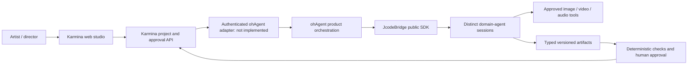

# Domain-specific agents and the ohAgent boundary

## Implementation in this iteration

Karmina owns the film production domain, not an agent execution engine.
`karmina/studio.py:AGENTS` defines six specialists with bounded responsibilities,
output kinds, and dependencies:

| Specialist | Artifact | Required preceding approval |
| --- | --- | --- |
| Producer | Production brief | None |
| Writer | Script | Producer |
| Art director | Visual bible | Writer |
| Director | Shot list | Art director |
| Sound designer | Sound plan | Director |
| Reviewer | Production review | Sound designer |

All preceding artifacts are pinned by immutable IDs in each new artifact's
`input_artifact_ids`. Each role has independent revision history. Director approval
is a separate action from drafting. A reviewer worksheet is not machine validation
and does not certify continuity, rights, or rendered media quality.

The current runtime is `local_template`: explicit localized worksheets with human
editing. It makes no model calls, creates no agent sessions, and costs nothing in
provider usage. Requests selecting `ohagent` return `runtime_unavailable` (503)
without modifying project state. There is no silent fallback from real execution
to templates. The browser prominently identifies this limitation.

## Source evidence inspected

The local ohAgent checkout was inspected read-only on 2026-11-24. Its worktree had
uncommitted changes, which were left untouched. These are observed local design
contracts, not claims about a released or deployed ohAgent API:

- `docs/JCODE_SDK_RUNTIME_ARCHITECTURE.md`: product policy and tenancy belong to
  ohAgent, model/tool sessions belong to Jcode through JcodeBridge's public SDK.
- `docs/AAAS_CONTRACT.md`: server-resolved identity, distinct specialist instances,
  immutable process versions, durable events, and separate artifact verification.
- `crates/ohagent-core/src/standard_agents.rs`: explicit bounded role definitions
  and deterministic checks rather than accepting model agreement as proof.

The inspected AaaS pilot supports an analytical brief with coordinator, analyst,
reviewer. It is not a generic cinema-agent execution API. Karmina must not submit
film tasks to that pilot and pretend they are supported.

## Intended live execution topology

Before connecting live execution:

1. Add an explicitly versioned cinema process in ohAgent with the above specialists.
   Do not flatten all roles into one generic prompt or reimplement its agent loop.
2. Agree server-to-server identity, tenant mapping, endpoint contract, and secret
   storage. Never pass browser-supplied tenant IDs or provider keys through the UI.
3. Map each invocation to tenant, project revision, role definition, session,
   attempt, input artifact IDs, and durable event cursor. Distinguish planned roles
   from actually running agent instances.
4. Validate role-specific output structure, required references, and duration totals
   before admitting a draft. Human approval remains explicit.
5. Add bounded asynchronous execution, idempotency, cancellation, interruption
   recovery, usage reconciliation, and approved spending reservations before paid
   image/video/audio tools are exposed.
6. Verify the real adapter and both production modes with representative original
   art. Template tests do not constitute this acceptance.

No live credentials, provider activation, ohAgent modifications, or deployment
were made for this iteration.

## Current technical limits

The standard-library Python HTTP server and SQLite JSON snapshots deliberately
keep the local vertical slice runnable without dependency or infrastructure setup.
They are not the final multi-user deployment design. There is no authentication,
asset upload, timeline editor, billing, model execution, render queue, or MP4 export.
The HTTP workspace has one fixed server-owned local tenant. Domain storage is
scoped by tenant and independently tested, but that is not SaaS authentication.

Host and Origin checks protect the loopback development interface from common
browser-origin misuse. They do not protect it from other programs or OS users on
the same machine. Do not expose it publicly or store sensitive customer data.
